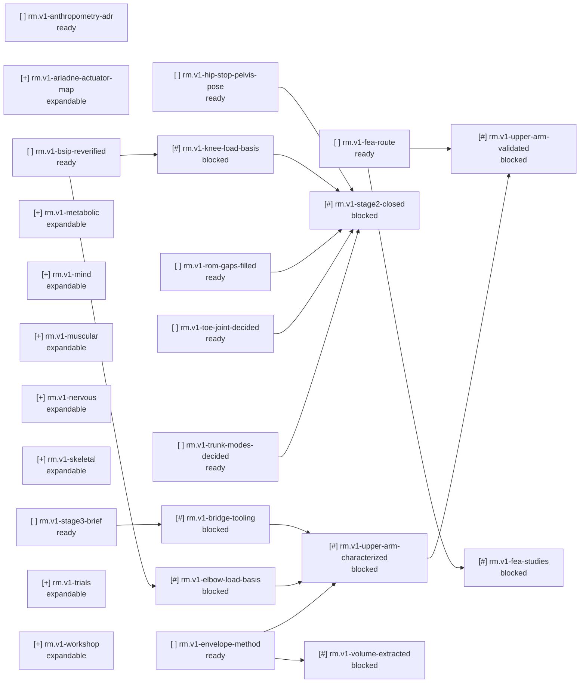

<!-- GENERATED by tools/roadmap from roadmap/nodes and the records its done_when criteria read (inputs sha256:d03c459b934c). Do not edit; change the inputs and rebuild. -->

# Roadmap status

## Counts

- ready: 9
- expandable: 8
- blocked: 11
- not_started: 8
- superseded (not counted): 0
- nodes: 36

## Problems

Errors:

none

Warnings:

none

## Frontier

- `rm.v1-anthropometry-adr` Anthropometric basis recorded as an accepted ADR: Dumas 2007 female, Harrington hip centre, landmark knee and ankle centres, LJC pelvis origin, residual-mass rule (decision: decisions/0002-anthropometric-basis.md, 0.5 d)
- `rm.v1-ariadne-actuator-map` Every v1 actuated joint's envelope mapped from the model's hinge axes into its actuator's own coordinates (stub, not yet decomposed)
- `rm.v1-bsip-reverified` Every BSIP row in the sheet re-verified against its published source before simulation output is used for sizing (manual, 2 d)
- `rm.v1-envelope-method` Method for extracting available volume from the body envelope decided and recorded (decision: decisions/0007-envelope-extraction.md, 1.5 d)
- `rm.v1-fea-route` FEA route for v1 parts decided and recorded: tool, how load cases enter, how results are recorded and checked (decision: decisions/0006-fea-route.md, 1.5 d)
- `rm.v1-hip-stop-pelvis-pose` Hip extension stop and design pelvis pitch decided together and recorded (decision: decisions/0004-hip-stop-pelvis-pose.md, 0.5 d)
- `rm.v1-metabolic` Onboard battery, power distribution and cooling sustain the acceptance trial with margin. (stub, not yet decomposed)
- `rm.v1-mind` Onboard control stack (state estimation, balance, gait) runs on the Jetson and passes the acceptance protocol in simulation. (stub, not yet decomposed)
- `rm.v1-muscular` Every v1 actuator and transmission, spine included, installed and bench-qualified to its envelope. (stub, not yet decomposed)
- `rm.v1-nervous` Every v1 sensor, harness and joint controller installed and passing its bench checks. (stub, not yet decomposed)
- `rm.v1-rom-gaps-filled` The seven Joint ROM values memo12 lists as missing are sourced and entered in the sheet (manual, 1 d)
- `rm.v1-skeletal` v1 skeleton fabricated in final form, every link and joint verified against its load envelope. (stub, not yet decomposed)
- `rm.v1-stage3-brief` Stage 3 brief written, with the bridge's gate criteria stated before any tooling is built (artifact: docs/briefs/ariadne/stage3-brief.md, 1 d)
- `rm.v1-toe-joint-decided` Toe-joint question settled: adr-0001 accepted, with its Decision section stating the outcome (decision: decisions/0001-toe-joint.md, 0.5 d)
- `rm.v1-trials` Integration ladder complete: joint, limb, lower-body and whole-body trials pass, ending in the acceptance protocol. (stub, not yet decomposed)
- `rm.v1-trunk-modes-decided` Lumbosacral sizing mode and v1 gait trunk mode chosen and recorded (decision: decisions/0005-trunk-modes.md, 0.5 d)
- `rm.v1-workshop` Every v1 part can be made in-house or sourced, with each in-house process qualified. (stub, not yet decomposed)

## Active

none

## Graph

