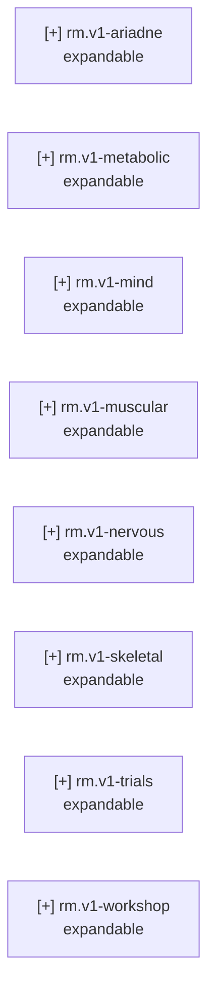

<!-- GENERATED by tools/roadmap from roadmap/nodes and the records its done_when criteria read (inputs sha256:b630c5b90e51). Do not edit; change the inputs and rebuild. -->

# Roadmap status

## Counts

- expandable: 8
- not_started: 1
- superseded (not counted): 0
- nodes: 9

## Problems

Errors:

none

Warnings:

none

## Frontier

- `rm.v1-ariadne` Every v1 part traces from the anthropometry sheet through simulated loads to a validated CAD model. (stub, not yet decomposed)
- `rm.v1-metabolic` Onboard battery, power distribution and cooling sustain the acceptance trial with margin. (stub, not yet decomposed)
- `rm.v1-mind` Onboard control stack (state estimation, balance, gait) runs on the Jetson and passes the acceptance protocol in simulation. (stub, not yet decomposed)
- `rm.v1-muscular` Every v1 actuator and transmission, spine included, installed and bench-qualified to its envelope. (stub, not yet decomposed)
- `rm.v1-nervous` Every v1 sensor, harness and joint controller installed and passing its bench checks. (stub, not yet decomposed)
- `rm.v1-skeletal` v1 skeleton fabricated in final form, every link and joint verified against its load envelope. (stub, not yet decomposed)
- `rm.v1-trials` Integration ladder complete: joint, limb, lower-body and whole-body trials pass, ending in the acceptance protocol. (stub, not yet decomposed)
- `rm.v1-workshop` Every v1 part can be made in-house or sourced, with each in-house process qualified. (stub, not yet decomposed)

## Active

none

## Graph

