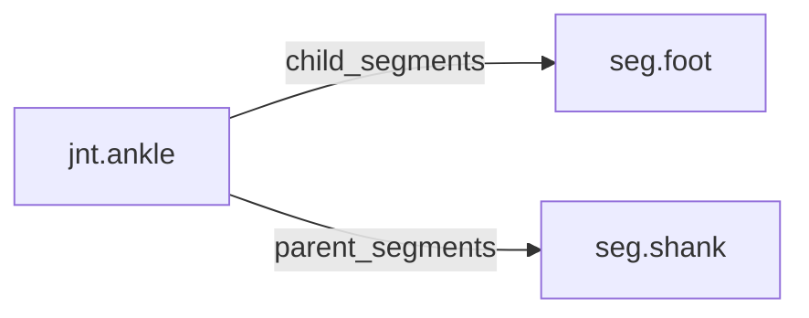

<!-- GENERATED by tools/thread (fy thread build) from thread/records, thread/stamps, decisions, params/snapshot.csv and sim/models/freyja.xml (snapshot sha256:e5cc96ceed7e), inputs sha256:9fd30ca50521. Do not edit; change the inputs and rebuild. -->

# jnt.ankle

Kind: joint. Status: **active**.

The ankle, between the shank and the foot, modelled as plantar-dorsiflexion and inversion-eversion hinges.

## Binding and values

Model hinges: `ankle_ie_left`, `ankle_ie_right`, `ankle_pdflex_left`, `ankle_pdflex_right`.
Parent segments: [seg.shank](seg.shank.md). Child segments: [seg.foot](seg.foot.md).

| ROM key | value | sheet source |
|---|---|---|
| `ankle_dorsiflexion` | 25 | 'MuJoCo Reference'!G79 |
| `ankle_eversion` | 19.2 | 'MuJoCo Reference'!G82 |
| `ankle_inversion` | 36.2 | 'MuJoCo Reference'!G81 |
| `ankle_plantarflexion` | 62.1 | 'MuJoCo Reference'!G80 |

## Relations

Authored:

- hinges: `["ankle_pdflex","ankle_ie"]`
- rom_keys: `["ankle_dorsiflexion","ankle_plantarflexion","ankle_inversion","ankle_eversion"]`
- sides: `["left","right"]`

Derived:

- acted_on_by: none
- child_segments: [seg.foot](seg.foot.md)
- consumed_by: none
- interfaces: none
- parent_segments: [seg.shank](seg.shank.md)

## Budgets

None.

## Work

None.

## Decisions

None.

## References

None.

## Neighbourhood

