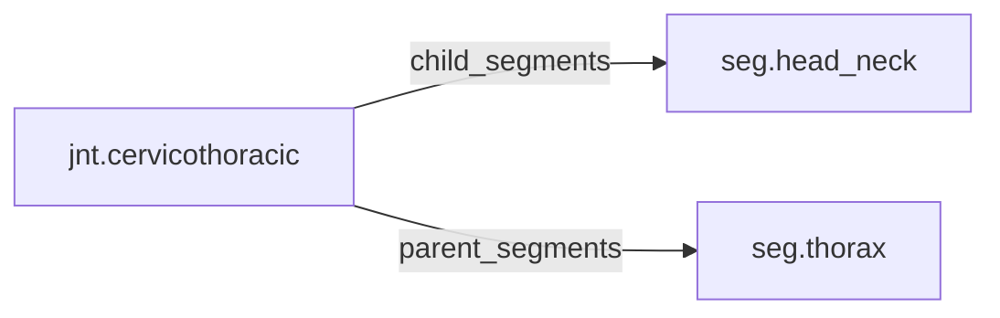

<!-- GENERATED by tools/thread (fy thread build) from thread/records, thread/stamps, decisions, params/snapshot.csv and sim/models/freyja.xml (snapshot sha256:cf4fdfe08804), inputs sha256:d34a5ca61a4d. Do not edit; change the inputs and rebuild. -->

# jnt.cervicothoracic

Kind: joint. Status: **active**.

The cervicothoracic junction between the neck and the thorax, modelled as three hinges.

## Binding and values

Model hinges: `cj_ax`, `cj_fe`, `cj_lat`.
Parent segments: [seg.thorax](seg.thorax.md). Child segments: [seg.head_neck](seg.head_neck.md).

No values.

## Relations

Authored:

- hinges: `["cj_fe","cj_lat","cj_ax"]`
- rom_keys: `[]`

Derived:

- acted_on_by: none
- child_segments: [seg.head_neck](seg.head_neck.md)
- consumed_by: none
- interfaces: none
- parent_segments: [seg.thorax](seg.thorax.md)

## Budgets

None.

## Work

None.

## Decisions

None.

## References

None in roadmap/nodes/.

Mentions in memos, notebook and log are not part of this file: run `python tools/fy thread refs jnt.cervicothoracic`.

## Neighbourhood

