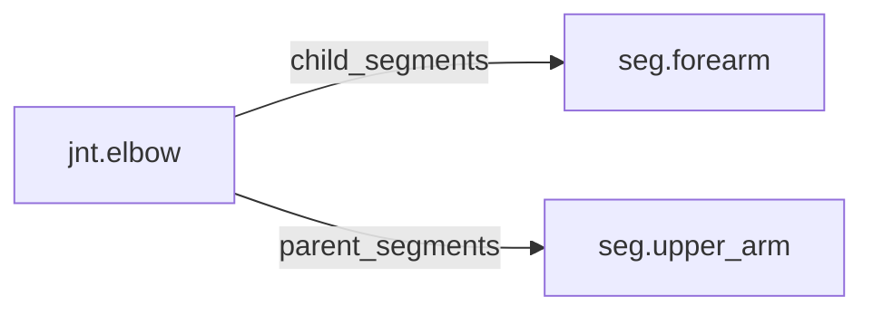

<!-- GENERATED by tools/thread (fy thread build) from thread/records, thread/stamps, decisions, params/snapshot.csv and sim/models/freyja.xml (snapshot sha256:cf4fdfe08804), inputs sha256:9e6a1f586679. Do not edit; change the inputs and rebuild. -->

# jnt.elbow

Kind: joint. Status: **active**.

The elbow, a hinge between the upper arm and the forearm.

## Binding and values

Model hinges: `elbow_left`, `elbow_right`.
Parent segments: [seg.upper_arm](seg.upper_arm.md). Child segments: [seg.forearm](seg.forearm.md).

| ROM key | value | sheet source |
|---|---|---|
| `elbow_extension` | 4.7 | 'MuJoCo Reference'!G92 |
| `elbow_flexion` | 150 | 'MuJoCo Reference'!G91 |

## Relations

Authored:

- hinges: `["elbow"]`
- rom_keys: `["elbow_flexion","elbow_extension"]`
- sides: `["left","right"]`

Derived:

- acted_on_by: none
- child_segments: [seg.forearm](seg.forearm.md)
- consumed_by: none
- interfaces: none
- parent_segments: [seg.upper_arm](seg.upper_arm.md)

## Budgets

None.

## Work

None.

## Decisions

None.

## References

None in roadmap/nodes/.

Mentions in memos, notebook and log are not part of this file: run `python tools/fy thread refs jnt.elbow`.

## Neighbourhood

