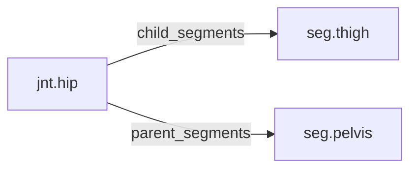

<!-- GENERATED by tools/thread (fy thread build) from thread/records, thread/stamps, decisions, params/snapshot.csv and sim/models/freyja.xml (snapshot sha256:cf4fdfe08804), inputs sha256:e8cfe7d39897. Do not edit; change the inputs and rebuild. -->

# jnt.hip

Kind: joint. Status: **active**.

The hip, a ball-and-socket joint between the pelvis and the thigh, modelled as three hinges.

## Binding and values

Model hinges: `hip_aa_left`, `hip_aa_right`, `hip_fe_left`, `hip_fe_right`, `hip_ier_left`, `hip_ier_right`.
Parent segments: [seg.pelvis](seg.pelvis.md). Child segments: [seg.thigh](seg.thigh.md).

| ROM key | value | sheet source |
|---|---|---|
| `hip_abduction` | 40.5 | 'MuJoCo Reference'!G71 |
| `hip_adduction` | 25.6 | 'MuJoCo Reference'!G72 |
| `hip_extension` | 31 | 'MuJoCo Reference'!G70 |
| `hip_external_rotation` | 44.2 | 'MuJoCo Reference'!G74 |
| `hip_flexion` | 133.8 | 'MuJoCo Reference'!G69 |
| `hip_internal_rotation` | 44.4 | 'MuJoCo Reference'!G73 |

## Relations

Authored:

- hinges: `["hip_fe","hip_aa","hip_ier"]`
- rom_keys: `["hip_flexion","hip_extension","hip_abduction","hip_adduction","hip_external_rotation","hip_internal_rotation"]`
- sides: `["left","right"]`

Derived:

- acted_on_by: none
- child_segments: [seg.thigh](seg.thigh.md)
- consumed_by: none
- interfaces: none
- parent_segments: [seg.pelvis](seg.pelvis.md)

## Budgets

None.

## Work

None.

## Decisions

None.

## References

None in roadmap/nodes/.

Mentions in memos, notebook and log are not part of this file: run `python tools/fy thread refs jnt.hip`.

## Neighbourhood

