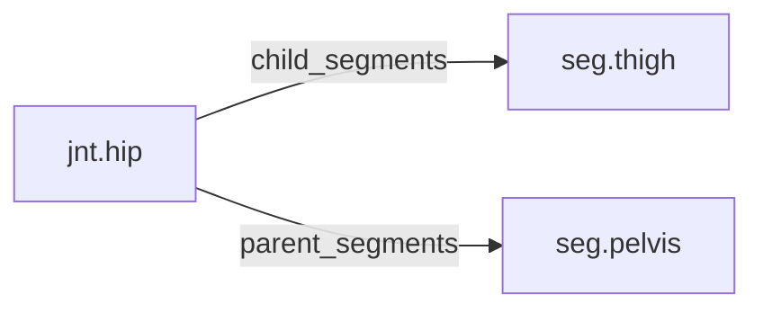

<!-- GENERATED by tools/thread (fy thread build) from thread/records, thread/stamps, decisions, params/snapshot.csv and sim/models/freyja.xml (snapshot sha256:e5cc96ceed7e), inputs sha256:2ebed790a394. Do not edit; change the inputs and rebuild. -->

# jnt.hip

Kind: joint. Status: **active**.

The hip, a ball-and-socket joint between the pelvis and the thigh, modelled as three hinges.

## Binding and values

Model hinges: `hip_aa_left`, `hip_aa_right`, `hip_fe_left`, `hip_fe_right`, `hip_ier_left`, `hip_ier_right`.
Parent segments: [seg.pelvis](seg.pelvis.md). Child segments: [seg.thigh](seg.thigh.md).

| ROM key | value | sheet source |
|---|---|---|
| `hip_abduction` | 40.5 | 'MuJoCo Reference'!G73 |
| `hip_adduction` | 25.6 | 'MuJoCo Reference'!G74 |
| `hip_extension` | 31 | 'MuJoCo Reference'!G72 |
| `hip_external_rotation` | 44.2 | 'MuJoCo Reference'!G76 |
| `hip_flexion` | 133.8 | 'MuJoCo Reference'!G71 |
| `hip_internal_rotation` | 44.4 | 'MuJoCo Reference'!G75 |

## Relations

Authored:

- hinges: `["hip_fe","hip_aa","hip_ier"]`
- rom_keys: `["hip_flexion","hip_extension","hip_abduction","hip_adduction","hip_external_rotation","hip_internal_rotation"]`
- sides: `["left","right"]`

Derived:

- acted_on_by: none
- child_segments: [seg.thigh](seg.thigh.md)
- consumed_by: none
- interfaces: none
- parent_segments: [seg.pelvis](seg.pelvis.md)

## Budgets

None.

## Work

None.

## Decisions

None.

## References

- `docs/memos/memo18-stage3a-part-a.md:72` `tests/test_thread_reallocation.py`, 9 tests, all pass. Fixture: M1 (pelvis) and M2 (thigh), both bilateral, acting across `jnt.hip`; M3 in the shank; `hn.leg-power` pelvis > thigh > shank; six work i
- `docs/memos/memo18-stage3a-part-a.md:74` - Changed files after the edit: `part.hip.m2`, `seg.thigh`, `seg.pelvis`, `work.thigh-houses`, `work.pelvis-houses`, `work.m2-mount`, `work.pelvis-mass` (derived and dossier each, 14), plus `graph.jso
- `docs/memos/memo19-stage3a-part-b.md:83` 6. **Choices recorded for later:** references use the roadmap's whole-token rule, so `seg.thigh2` and `xseg.thigh` do not match `seg.thigh`; a reference line is cut at 200 characters (the roadmap's ca
- `docs/memos/memo19-stage3a-part-b.md:90` - A query-rule test I wrote assumed `hip` is ambiguous; by the roadmap's rule (a kind prefix added when exactly one record has it) it resolves to `jnt.hip`. I changed the test to use `m2`, which is am

## Neighbourhood

