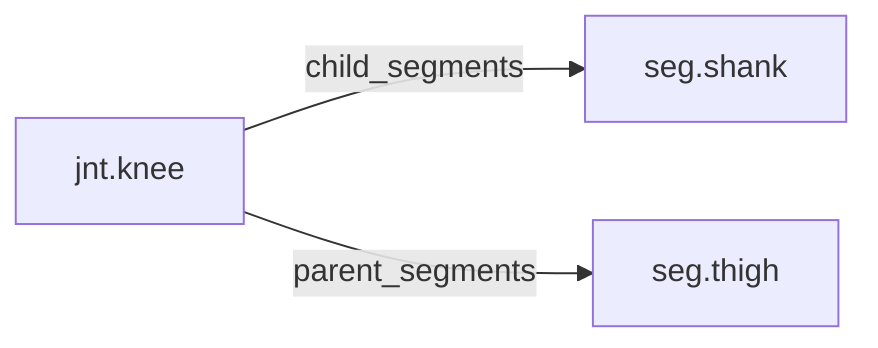

<!-- GENERATED by tools/thread (fy thread build) from thread/records, thread/stamps, decisions, params/snapshot.csv and sim/models/freyja.xml (snapshot sha256:e5cc96ceed7e), inputs sha256:096943fd4f0e. Do not edit; change the inputs and rebuild. -->

# jnt.knee

Kind: joint. Status: **active**.

The knee, a hinge between the thigh and the shank.

## Binding and values

Model hinges: `knee_left`, `knee_right`.
Parent segments: [seg.thigh](seg.thigh.md). Child segments: [seg.shank](seg.shank.md).

| ROM key | value | sheet source |
|---|---|---|
| `knee_extension` | 1.6 | 'MuJoCo Reference'!G78 |
| `knee_flexion` | 141.9 | 'MuJoCo Reference'!G77 |

## Relations

Authored:

- hinges: `["knee"]`
- rom_keys: `["knee_flexion","knee_extension"]`
- sides: `["left","right"]`

Derived:

- acted_on_by: none
- child_segments: [seg.shank](seg.shank.md)
- consumed_by: none
- interfaces: none
- parent_segments: [seg.thigh](seg.thigh.md)

## Budgets

None.

## Work

None.

## Decisions

None.

## References

None in roadmap/nodes/.

Mentions in memos, notebook and log are not part of this file: run `python tools/fy thread refs jnt.knee`.

## Neighbourhood

