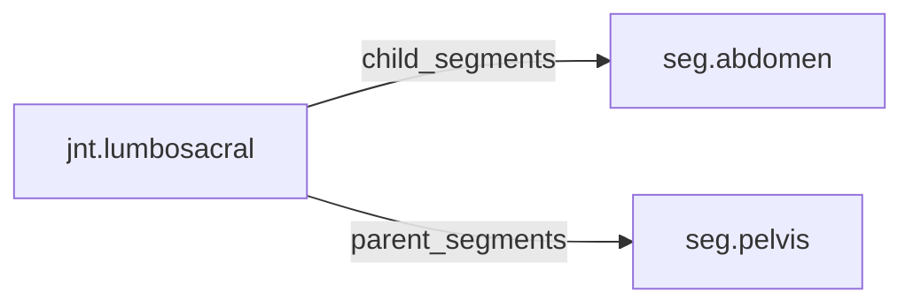

<!-- GENERATED by tools/thread (fy thread build) from thread/records, thread/stamps, decisions, params/snapshot.csv and sim/models/freyja.xml (snapshot sha256:492fe816e6d8), inputs sha256:9e8fec0b3e90. Do not edit; change the inputs and rebuild. -->

# jnt.lumbosacral

Kind: joint. Status: **active**.

The lumbosacral joint between the pelvis and the lumbar spine, modelled as three hinges.

## Binding and values

Model hinges: `lsj_ax`, `lsj_fe`, `lsj_lat`.
Parent segments: [seg.pelvis](seg.pelvis.md). Child segments: [seg.abdomen](seg.abdomen.md).

| ROM key | value | sheet source |
|---|---|---|
| `lumbosacral_axial_rotation` | 38.5 | 'MuJoCo Reference'!G84 |
| `lumbosacral_extension` | 40 | 'MuJoCo Reference'!G82 |
| `lumbosacral_flexion` | 69.9 | 'MuJoCo Reference'!G81 |
| `lumbosacral_lateral_bending` | 36.3 | 'MuJoCo Reference'!G83 |

## Relations

Authored:

- hinges: `["lsj_fe","lsj_lat","lsj_ax"]`
- rom_keys: `["lumbosacral_flexion","lumbosacral_extension","lumbosacral_lateral_bending","lumbosacral_axial_rotation"]`

Derived:

- acted_on_by: none
- child_segments: [seg.abdomen](seg.abdomen.md)
- consumed_by: none
- interfaces: none
- parent_segments: [seg.pelvis](seg.pelvis.md)

## Budgets

None.

## Work

None.

## Decisions

None.

## References

None in roadmap/nodes/.

Mentions in memos, notebook and log are not part of this file: run `python tools/fy thread refs jnt.lumbosacral`.

## Neighbourhood

