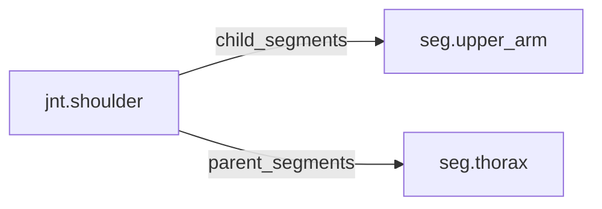

<!-- GENERATED by tools/thread (fy thread build) from thread/records, thread/stamps, decisions, params/snapshot.csv and sim/models/freyja.xml (snapshot sha256:e5cc96ceed7e), inputs sha256:1a63e2c4cc4b. Do not edit; change the inputs and rebuild. -->

# jnt.shoulder

Kind: joint. Status: **active**.

The shoulder, between the thorax and the upper arm, modelled as three hinges.

## Binding and values

Model hinges: `shoulder_aa_left`, `shoulder_aa_right`, `shoulder_fe_left`, `shoulder_fe_right`, `shoulder_ier_left`, `shoulder_ier_right`.
Parent segments: [seg.thorax](seg.thorax.md). Child segments: [seg.upper_arm](seg.upper_arm.md).

| ROM key | value | sheet source |
|---|---|---|
| `shoulder_abduction` | 182.7 | 'MuJoCo Reference'!G89 |
| `shoulder_extension` | 57.3 | 'MuJoCo Reference'!G88 |
| `shoulder_flexion` | 172 | 'MuJoCo Reference'!G87 |

Not in the snapshot (the sheet has no value, so the hinge is unlimited): `shoulder_adduction`, `shoulder_external_rotation`, `shoulder_internal_rotation`.

## Relations

Authored:

- hinges: `["shoulder_fe","shoulder_aa","shoulder_ier"]`
- rom_keys: `["shoulder_flexion","shoulder_extension","shoulder_abduction","shoulder_adduction","shoulder_external_rotation","shoulder_internal_rotation"]`
- sides: `["left","right"]`

Derived:

- acted_on_by: none
- child_segments: [seg.upper_arm](seg.upper_arm.md)
- consumed_by: none
- interfaces: none
- parent_segments: [seg.thorax](seg.thorax.md)

## Budgets

None.

## Work

None.

## Decisions

None.

## References

None.

## Neighbourhood

