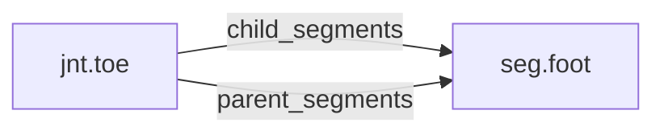

<!-- GENERATED by tools/thread (fy thread build) from thread/records, thread/stamps, decisions, params/snapshot.csv and sim/models/freyja.xml (snapshot sha256:cf4fdfe08804), inputs sha256:61281caf495c. Do not edit; change the inputs and rebuild. -->

# jnt.toe

Kind: joint. Status: **proposed** (PROPOSED: not yet accepted).

The metatarsophalangeal joint, between the foot and the toe, a passive hinge with a spring, a damper and stops.

## Binding and values

Model hinges: `toe_left`, `toe_right`.
Parent segments: [seg.foot](seg.foot.md). Child segments: [seg.foot](seg.foot.md).

| ROM key | value | sheet source |
|---|---|---|
| `toe_extension` | 80 | 'MuJoCo Reference'!G95 |
| `toe_flexion` | 0 | 'MuJoCo Reference'!G96 |

## Relations

Authored:

- hinges: `["toe"]`
- rom_keys: `["toe_extension","toe_flexion"]`
- sides: `["left","right"]`

Derived:

- acted_on_by: none
- child_segments: [seg.foot](seg.foot.md)
- consumed_by: none
- interfaces: none
- parent_segments: [seg.foot](seg.foot.md)

## Budgets

None.

## Work

None.

## Decisions

None.

## References

None in roadmap/nodes/.

Mentions in memos, notebook and log are not part of this file: run `python tools/fy thread refs jnt.toe`.

## Neighbourhood

