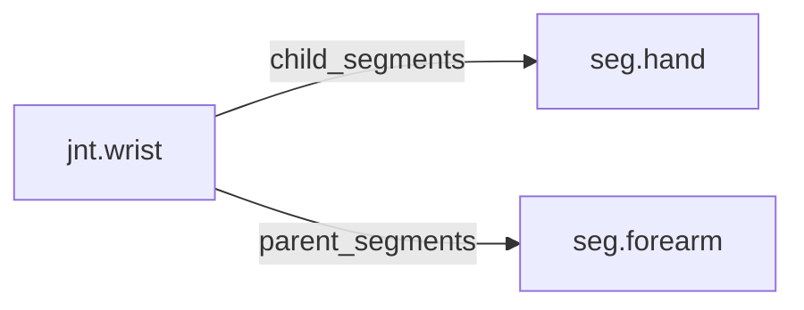

<!-- GENERATED by tools/thread (fy thread build) from thread/records, thread/stamps, decisions, params/snapshot.csv and sim/models/freyja.xml (snapshot sha256:e5cc96ceed7e), inputs sha256:cddea0ce17de. Do not edit; change the inputs and rebuild. -->

# jnt.wrist

Kind: joint. Status: **active**.

The wrist, between the forearm and the hand, modelled as one hinge.

## Binding and values

Model hinges: `wrist_left`, `wrist_right`.
Parent segments: [seg.forearm](seg.forearm.md). Child segments: [seg.hand](seg.hand.md).

| ROM key | value | sheet source |
|---|---|---|
| `wrist_extension` | 74 | 'MuJoCo Reference'!G93 |
| `wrist_flexion` | 74.8 | 'MuJoCo Reference'!G92 |

## Relations

Authored:

- hinges: `["wrist"]`
- rom_keys: `["wrist_flexion","wrist_extension"]`
- sides: `["left","right"]`

Derived:

- acted_on_by: none
- child_segments: [seg.hand](seg.hand.md)
- consumed_by: none
- interfaces: none
- parent_segments: [seg.forearm](seg.forearm.md)

## Budgets

None.

## Work

None.

## Decisions

None.

## References

None.

## Neighbourhood

