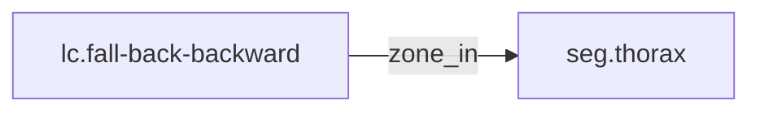

<!-- GENERATED by tools/thread (fy thread build) from thread/records, thread/stamps, decisions, params/snapshot.csv and sim/models/freyja.xml (snapshot sha256:492fe816e6d8), inputs sha256:b8827419d65a. Do not edit; change the inputs and rebuild. -->

# lc.fall-back-backward

Kind: load_case. Status: **proposed** (PROPOSED: not yet accepted).

Backward fall from standing, back first.

Notes: The energy is a design upper edge, not a measurement. "Sourced" means the cited decision exists and is accepted, not that its number is validated. The back zone has no cap yet; the cap and stroke are set by the owning record (adr-0044 D3), rm.v1-torso-structure. No energy is shared between zones or between limbs without a verified source (adr-0037 D1(c)). 540 J is the upper edge of the energy bound of adr-0037 D1(b), 473 to 537 J after its 2026-10-31 Revisions, rounded up to the next 10 J. No credit for leg buckling or bracing (adr-0036).

## Binding and values

No model or snapshot binding.

## Relations

Authored:

- zone_in: [seg.thorax](seg.thorax.md)
- independent_source_required: `true`
- source: `{"direction":"backward, back first","energy_basis":"E_max","energy_j":540,"zone":"back"}`

Derived:

- consumed_by: none

## Evidence

Sourcing: **sourced**.

- [adr-0037 D1(b)](../../decisions/0037-fall-design-basis.md): admissible. adr-0037 is accepted.

## Budgets

None.

## Work

None.

## Decisions

None.

## References

- `roadmap/nodes/rm.v1-fall-cases-recorded.md:19` | lc.fall-back-backward | back | backward, back first | 540 | E_max | seg.thorax | adr-0037 D1(b) |

Mentions in memos, notebook and log are not part of this file: run `python tools/fy thread refs lc.fall-back-backward`.

## Neighbourhood

