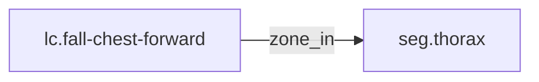

<!-- GENERATED by tools/thread (fy thread build) from thread/records, thread/stamps, decisions, params/snapshot.csv and sim/models/freyja.xml (snapshot sha256:492fe816e6d8), inputs sha256:d07678da8266. Do not edit; change the inputs and rebuild. -->

# lc.fall-chest-forward

Kind: load_case. Status: **proposed** (PROPOSED: not yet accepted).

Forward fall from standing, chest first, with the arm not arresting.

Notes: The energy is a design upper edge, not a measurement. "Sourced" means the cited decision exists and is accepted, not that its number is validated. The chest zone has no cap yet; the cap and stroke are set by the owning record (adr-0044 D3), rm.v1-torso-structure. No energy is shared between zones or between limbs without a verified source (adr-0037 D1(c)). 540 J is the upper edge of the energy bound of adr-0037 D1(b), 473 to 537 J after its 2026-10-31 Revisions, rounded up to the next 10 J. No credit for leg buckling or bracing (adr-0036). The scenario is a forward fall that the arm does not arrest, beyond adr-0008 D5's friction cone or short of the floor (adr-0044 D1).

## Binding and values

No model or snapshot binding.

## Relations

Authored:

- zone_in: [seg.thorax](seg.thorax.md)
- independent_source_required: `true`
- source: `{"direction":"forward, chest first, with the arm not arresting","energy_basis":"E_max","energy_j":540,"zone":"chest"}`

Derived:

- consumed_by: none

## Evidence

Sourcing: **sourced**.

- [adr-0037 D1(b)](../../decisions/0037-fall-design-basis.md): admissible. adr-0037 is accepted.
- [adr-0044 D1](../../decisions/0044-fall-zone-caps.md): admissible. adr-0044 is accepted.

## Budgets

None.

## Work

None.

## Decisions

None.

## References

- `roadmap/nodes/rm.v1-fall-cases-recorded.md:20` | lc.fall-chest-forward | chest | forward, chest first, arm not arresting | 540 | E_max | seg.thorax | adr-0037 D1(b); adr-0044 D1 |

Mentions in memos, notebook and log are not part of this file: run `python tools/fy thread refs lc.fall-chest-forward`.

## Neighbourhood

