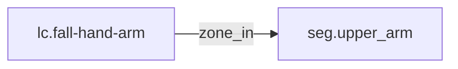

<!-- GENERATED by tools/thread (fy thread build) from thread/records, thread/stamps, decisions, params/snapshot.csv and sim/models/freyja.xml (snapshot sha256:492fe816e6d8), inputs sha256:508dfcbd4fd4. Do not edit; change the inputs and rebuild. -->

# lc.fall-hand-arm

Kind: load_case. Status: **proposed** (PROPOSED: not yet accepted).

Fall arrested on one arm, forward or sideways, with no sharing between arms.

Notes: The energy is a design upper edge, not a measurement. "Sourced" means the cited decision exists and is accepted, not that its number is validated. The hand-arm zone has no cap yet; the cap and stroke are set by the owning record (adr-0044 D3), rm.v1-shoulder-concept. No energy is shared between zones or between limbs without a verified source (adr-0037 D1(c)). 430 J is the upper edge of a pivot model about the toe: forward fall, arm straight at the friction cone's edge (45 degrees, mu = 1.0, [design], no source), band 378 to 422 J, rounded up. The model does not cover foot slip, and a slipping fall can reach E_max. The lateral band, 238 to 331 J, lies below, so this one case covers forward and sideways. The backward arrest is a separate case.

## Binding and values

No model or snapshot binding.

## Relations

Authored:

- zone_in: [seg.upper_arm](seg.upper_arm.md)
- independent_source_required: `true`
- source: `{"direction":"arrest on one arm, forward or sideways; no sharing","energy_basis":"geometric drop, one arm, friction cone mu = 1.0 (adr-0008 D5)","energy_j":430,"zone":"hand-arm"}`

Derived:

- consumed_by: none

## Evidence

Sourcing: **sourced**.

- [adr-0037 D3](../../decisions/0037-fall-design-basis.md): admissible. adr-0037 is accepted.
- [adr-0008 D5](../../decisions/0008-elbow-load-basis.md): admissible. adr-0008 is accepted.

## Budgets

None.

## Work

None.

## Decisions

None.

## References

- `roadmap/nodes/rm.v1-fall-cases-recorded.md:22` | lc.fall-hand-arm | hand-arm | forward or sideways, one arm, no sharing | 430 | geometric drop, mu = 1.0 cone | seg.upper_arm | adr-0037 D3; adr-0008 D5 |

Mentions in memos, notebook and log are not part of this file: run `python tools/fy thread refs lc.fall-hand-arm`.

## Neighbourhood

