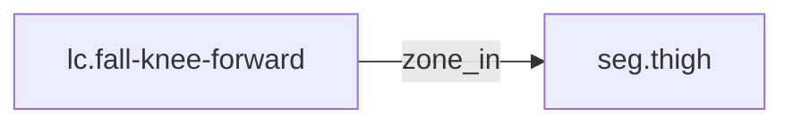

<!-- GENERATED by tools/thread (fy thread build) from thread/records, thread/stamps, decisions, params/snapshot.csv and sim/models/freyja.xml (snapshot sha256:492fe816e6d8), inputs sha256:ea2087aee2a4. Do not edit; change the inputs and rebuild. -->

# lc.fall-knee-forward

Kind: load_case. Status: **proposed** (PROPOSED: not yet accepted).

Forward collapse onto one knee.

Notes: The energy is a design upper edge, not a measurement. "Sourced" means the cited decision exists and is accepted, not that its number is validated. The knee zone has no cap yet; the cap and stroke are set by the owning record (adr-0044 D3), rm.v1-knee-concept-adr. No energy is shared between zones or between limbs without a verified source (adr-0037 D1(c)). 260 J rests on a centre-of-mass drop of 0.40 m chosen in adr-0037 D3 and tagged [design]; nothing sources it. adr-0037 Consequences gives about 360 J for a 0.55 m drop.

## Binding and values

No model or snapshot binding.

## Relations

Authored:

- zone_in: [seg.thigh](seg.thigh.md)
- independent_source_required: `true`
- source: `{"direction":"forward collapse onto one knee","energy_basis":"centre of mass drops 0.40 m","energy_j":260,"zone":"knee"}`

Derived:

- consumed_by: none

## Evidence

Sourcing: **sourced**.

- [adr-0037 D1(c)](../../decisions/0037-fall-design-basis.md): admissible. adr-0037 is accepted.
- [adr-0037 D3](../../decisions/0037-fall-design-basis.md): admissible. adr-0037 is accepted.

## Budgets

None.

## Work

None.

## Decisions

None.

## References

- `roadmap/nodes/rm.v1-fall-cases-recorded.md:21` | lc.fall-knee-forward | knee | forward collapse onto one knee | 260 | centre of mass drops 0.40 m | seg.thigh | adr-0037 D1(c), D3 |

Mentions in memos, notebook and log are not part of this file: run `python tools/fy thread refs lc.fall-knee-forward`.

## Neighbourhood

