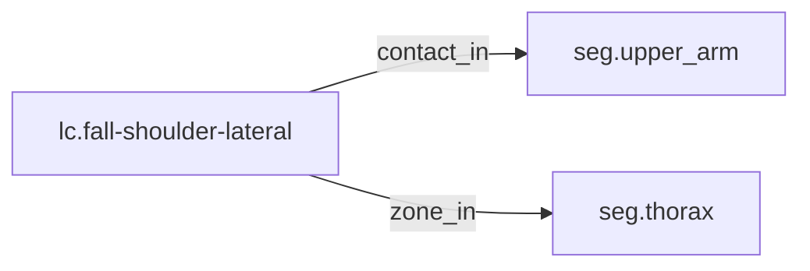

<!-- GENERATED by tools/thread (fy thread build) from thread/records, thread/stamps, decisions, params/snapshot.csv and sim/models/freyja.xml (snapshot sha256:492fe816e6d8), inputs sha256:9caa183d139c. Do not edit; change the inputs and rebuild. -->

# lc.fall-shoulder-lateral

Kind: load_case. Status: **proposed** (PROPOSED: not yet accepted).

Lateral fall from standing, shoulder first.

Notes: The energy is a design upper edge, not a measurement. "Sourced" means the cited decision exists and is accepted, not that its number is validated. The shoulder zone has no cap yet; the cap and stroke are set by the owning record (adr-0044 D3), rm.v1-shoulder-concept. No energy is shared between zones or between limbs without a verified source (adr-0037 D1(c)). 540 J is the upper edge of the energy bound of adr-0037 D1(b), 473 to 537 J after its 2026-10-31 Revisions, rounded up to the next 10 J. No credit for leg buckling or bracing (adr-0036). The skin it strikes is the upper arm's, not the thorax's: at the shoulder joint centre station the thorax ledger's lateral ray ends on a cut plane and the shoulder's skin lies in upper_arm_R, 34.3 mm beyond the joint centre at station 40 (memo 59, finding 7), so its contact is seg.upper_arm while its zone stays housed in the thorax (adr-0045 D5(d)).

## Binding and values

No model or snapshot binding.

## Relations

Authored:

- contact_in: [seg.upper_arm](seg.upper_arm.md)
- zone_in: [seg.thorax](seg.thorax.md)
- independent_source_required: `true`
- source: `{"direction":"lateral, shoulder first","energy_basis":"E_max","energy_j":540,"zone":"shoulder"}`

Derived:

- consumed_by: none

## Evidence

Sourcing: **sourced**.

- [adr-0037 D1(b)](../../decisions/0037-fall-design-basis.md): admissible. adr-0037 is accepted.

## Budgets

None.

## Work

None.

## Decisions

None.

## References

- `roadmap/nodes/rm.v1-fall-cases-recorded.md:18` | lc.fall-shoulder-lateral | shoulder | lateral, shoulder first | 540 | E_max | seg.thorax | adr-0037 D1(b) |
- `roadmap/nodes/rm.v1-fall-cases-recorded.md:39` Open for the characterization step, not decided here: the shoulder zone is housed in the thorax (adr-0037 D3), but its skin contact is on `upper_arm_R` (memo 59, finding 7). `seg.upper_arm`'s derived 
- `roadmap/nodes/rm.v1-upper-arm-char-contract.md:21` **Fall contact.** Memo 59 finding 7: lc.fall-shoulder-lateral is housed in the thorax but strikes upper_arm_R. The case record gains an optional `contact_in` field defaulting to `zone_in`. It means on
- `roadmap/nodes/rm.v1-upper-arm-char-schema.md:14` Delegate. The characterization schema the contract record names, and the optional `contact_in` field on the case record with its CONVENTIONS section 8 amendment and thread-record schema change in the 
- `roadmap/nodes/rm.v1-upper-arm-loads-computed.md:13` Delegate. Demand only, per the contract record: the cases decision 0008 accepts (static gravity sweep with payload, minimum-jerk swing with robot inertias from the snapshot) and the fall cases whose c

Mentions in memos, notebook and log are not part of this file: run `python tools/fy thread refs lc.fall-shoulder-lateral`.

## Neighbourhood

