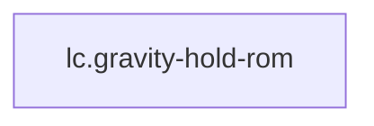

<!-- GENERATED by tools/thread (fy thread build) from thread/records, thread/stamps, decisions, params/snapshot.csv and sim/models/freyja.xml (snapshot sha256:e5cc96ceed7e), inputs sha256:4b2906576bf8. Do not edit; change the inputs and rebuild. -->

# lc.gravity-hold-rom

Kind: load_case. Status: **proposed** (PROPOSED: not yet accepted).

Any joint held anywhere in its range of motion against gravity, with the rest of the body supported.

Notes: Not an impact or other contact transient: the loads come from rigid-body inverse dynamics at zero velocity on a gantry with the ground reaction supplied explicitly (no contact solver), so the simulation's physics is not the untrusted part. It records the gravity-torque curve over each joint's range.

## Binding and values

No model or snapshot binding.

## Relations

Authored:

- independent_source_required: `false`
- source: `{"scenario":"rom_sweep"}`

Derived:

- consumed_by: none

## Budgets

None.

## Work

None.

## Decisions

None.

## References

None.

## Neighbourhood

