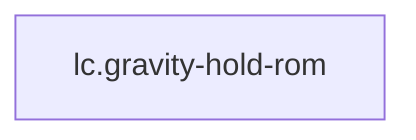

<!-- GENERATED by tools/thread (fy thread build) from thread/records, thread/stamps, decisions, params/snapshot.csv and sim/models/freyja.xml (snapshot sha256:cf4fdfe08804), inputs sha256:6d431a6d0546. Do not edit; change the inputs and rebuild. -->

# lc.gravity-hold-rom

Kind: load_case. Status: **proposed** (PROPOSED: not yet accepted).

Each limited joint swept through its range against gravity, one at a time, with the other joints at the reference pose and the pelvis held by the gantry.

Notes: Not an impact or other contact transient: the loads come from rigid-body inverse dynamics at zero velocity on a gantry that holds the pelvis (no contact solver), so the simulation's physics is not the untrusted part. It records the gravity-torque curve over each joint's range. The 13 unlimited hinges are skipped, not invented: the lumbosacral, shoulder abduction-adduction and shoulder rotation hinges lack sheet ROM values (the seven missing sheet ROM values) and the thoracolumbar and cervicothoracic hinges are the template's bare joints. Sweeping one joint at a time is near-worst, not a bound, for a proximal joint whose distal pose matters.

## Binding and values

No model or snapshot binding.

## Relations

Authored:

- independent_source_required: `false`
- source: `{"scenario":"rom_sweep"}`

Derived:

- consumed_by: none

## Budgets

None.

## Work

None.

## Decisions

None.

## References

None in roadmap/nodes/.

Mentions in memos, notebook and log are not part of this file: run `python tools/fy thread refs lc.gravity-hold-rom`.

## Neighbourhood

