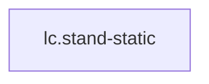

<!-- GENERATED by tools/thread (fy thread build) from thread/records, thread/stamps, decisions, params/snapshot.csv and sim/models/freyja.xml (snapshot sha256:e5cc96ceed7e), inputs sha256:72216c74340d. Do not edit; change the inputs and rebuild. -->

# lc.stand-static

Kind: load_case. Status: **proposed** (PROPOSED: not yet accepted).

Quiet standing at the design pose: the joint torques that hold it, from statics alone.

Notes: Not an impact or other contact transient: the loads come from rigid-body statics with the ground reaction supplied explicitly (no contact solver), so the simulation's physics is not the untrusted part. The CoM position over the ankle is a design choice, not a measurement; that stays on the envelope row.

## Binding and values

No model or snapshot binding.

## Relations

Authored:

- independent_source_required: `false`
- source: `{"scenario":"stand_static"}`

Derived:

- consumed_by: none

## Budgets

None.

## Work

None.

## Decisions

None.

## References

- `docs/memos/memo19-stage3a-part-b.md:37` **T7.** The records were written once from the proposal in `seed.py`, which is deleted; the fixture now copies `thread/records/seg.*` and `jnt.*`. If the real store is invalid the fixture, and so ever

## Neighbourhood

