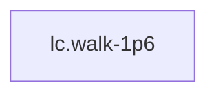

<!-- GENERATED by tools/thread (fy thread build) from thread/records, thread/stamps, decisions, params/snapshot.csv and sim/models/freyja.xml (snapshot sha256:e5cc96ceed7e), inputs sha256:49ca854c85ec. Do not edit; change the inputs and rebuild. -->

# lc.walk-1p6

Kind: load_case. Status: **proposed** (PROPOSED: not yet accepted).

Level walking at 1.6 m/s, the faster condition above the design speed.

Notes: Not an impact or other contact transient: the loads come from rigid-body inverse dynamics with the ground reaction supplied explicitly (no contact solver), so the simulation's physics is not the untrusted part. The envelope rows are provisional (method A with the measured centre of pressure); that trust stays on the envelope rows and in the load-basis decision records.

## Binding and values

No model or snapshot binding.

## Relations

Authored:

- independent_source_required: `false`
- source: `{"condition":"1.6 m/s level treadmill walking","gait_spec":"walk_treadmill"}`

Derived:

- consumed_by: none

## Budgets

None.

## Work

None.

## Decisions

None.

## References

- `docs/memos/memo19-stage3a-part-b.md:37` **T7.** The records were written once from the proposal in `seed.py`, which is deleted; the fixture now copies `thread/records/seg.*` and `jnt.*`. If the real store is invalid the fixture, and so ever

## Neighbourhood

