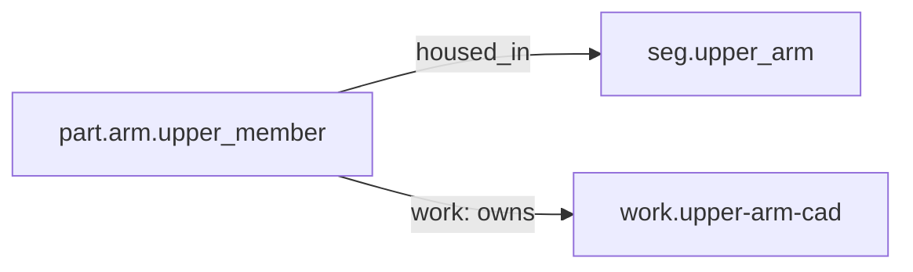

<!-- GENERATED by tools/thread (fy thread build) from thread/records, thread/stamps, decisions, params/snapshot.csv and sim/models/freyja.xml (snapshot sha256:492fe816e6d8), inputs sha256:f0c831f48130. Do not edit; change the inputs and rebuild. -->

# part.arm.upper_member

Kind: part. Status: **proposed** (PROPOSED: not yet accepted).

A bridge test article, not a design: a plain 6061 tube from the shoulder joint centre to the elbow joint centre, modelled in Fusion to prove the CAD bridge (Stage 3b). To be revised under the same id when the upper arm's design starts.

## Binding and values

No model or snapshot binding.

## Relations

Authored:

- housed_in: [seg.upper_arm](seg.upper_arm.md)
- category: `"structure"`
- mass: `{"address":"cad/sidecars/part.arm.upper_member.json#/mass_properties/mass_kg","source":"CAD sidecar of the placeholder tube (fy cad pull)"}`
- sides: `["left","right"]`

Derived:

- consumed_by: none
- interfaces: none

## Budgets

None.

## Work

- [work.upper-arm-cad](work.upper-arm-cad.md): unstamped (owns)

## Decisions

None.

## References

None in roadmap/nodes/.

Mentions in memos, notebook and log are not part of this file: run `python tools/fy thread refs part.arm.upper_member`.

## Neighbourhood

