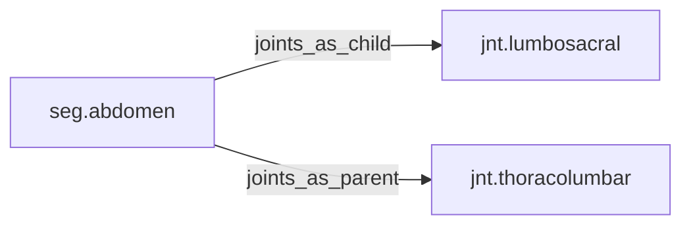

<!-- GENERATED by tools/thread (fy thread build) from thread/records, thread/stamps, decisions, params/snapshot.csv and sim/models/freyja.xml (snapshot sha256:492fe816e6d8), inputs sha256:5830ef969215. Do not edit; change the inputs and rebuild. -->

# seg.abdomen

Kind: segment. Status: **active**.

The lumbar spine and abdominal wall between the pelvis and the thorax.

## Binding and values

Model bodies: `abdomen`. Values are read from the right side for a bilateral segment.

| snapshot key | value | sheet source |
|---|---|---|
| `abdomen_com_x` | 0.031010490807 | 'MuJoCo Reference'!D17 |
| `abdomen_com_y` | -0.000635460877192 | 'MuJoCo Reference'!E17 |
| `abdomen_com_z` | -0.052743252807 | 'MuJoCo Reference'!F17 |
| `abdomen_ixx` | 0.0193234401311 | 'MuJoCo Reference'!G17 |
| `abdomen_ixy` | 3.87415819068e-05 | 'MuJoCo Reference'!J17 |
| `abdomen_ixz` | 0.00172184808475 | 'MuJoCo Reference'!K17 |
| `abdomen_iyy` | 0.0130214761409 | 'MuJoCo Reference'!H17 |
| `abdomen_iyz` | 0.000107615505297 | 'MuJoCo Reference'!L17 |
| `abdomen_izz` | 0.0255220932362 | 'MuJoCo Reference'!I17 |
| `abdomen_jpos_z` | -0.127092175438 | 'MuJoCo Positions '!E6 |
| `abdomen_length` | 0.127092175438 | 'MuJoCo Reference'!C17 |
| `abdomen_mass` | 2.665 | 'MuJoCo Reference'!B17 |
| `abdomen_pos_x` | 0 | 'MuJoCo Positions '!B6 |
| `abdomen_pos_y` | 0 | 'MuJoCo Positions '!C6 |
| `abdomen_pos_z` | 0.127092175438 | 'MuJoCo Positions '!D6 |

## Relations

Authored:

- body: `"abdomen"`

Derived:

- consumed_by: none
- crossed_by: none
- houses: none
- interfaces: none
- joints_as_child: [jnt.lumbosacral](jnt.lumbosacral.md)
- joints_as_parent: [jnt.thoracolumbar](jnt.thoracolumbar.md)
- reacted_by: none

## Budgets

Mass: target 2.665 kg, claimed 0 kg, remaining 2.665 kg.

## Work

None.

## Decisions

None.

## References

None in roadmap/nodes/.

Mentions in memos, notebook and log are not part of this file: run `python tools/fy thread refs seg.abdomen`.

## Neighbourhood

