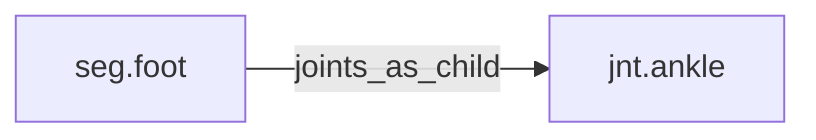

<!-- GENERATED by tools/thread (fy thread build) from thread/records, thread/stamps, decisions, params/snapshot.csv and sim/models/freyja.xml (snapshot sha256:e5cc96ceed7e), inputs sha256:15175842e47a. Do not edit; change the inputs and rebuild. -->

# seg.foot

Kind: segment. Status: **active**.

The foot, distal to the ankle.

## Binding and values

Model bodies: `foot_left`, `foot_right`. Values are read from the right side for a bilateral segment.

| snapshot key | value | sheet source |
|---|---|---|
| `foot_right_com_x` | 0.04455 | 'MuJoCo Reference'!D24 |
| `foot_right_com_y` | -0.006435 | 'MuJoCo Reference'!E24 |
| `foot_right_com_z` | -0.03597 | 'MuJoCo Reference'!F24 |
| `foot_right_ixx` | 0.000511421625 | 'MuJoCo Reference'!G24 |
| `foot_right_ixy` | -6.37065e-05 | 'MuJoCo Reference'!J24 |
| `foot_right_ixz` | -0.0001769625 | 'MuJoCo Reference'!K24 |
| `foot_right_iyy` | 0.002167790625 | 'MuJoCo Reference'!H24 |
| `foot_right_iyz` | 2.8314e-05 | 'MuJoCo Reference'!L24 |
| `foot_right_izz` | 0.002293434 | 'MuJoCo Reference'!I24 |
| `foot_right_jpos_z` | 0 | 'MuJoCo Positions '!E14 |
| `foot_right_length` | 0.165 | 'MuJoCo Reference'!C24 |
| `foot_right_mass` | 0.65 | 'MuJoCo Reference'!B24 |
| `foot_right_pos_x` | 0 | 'MuJoCo Positions '!B14 |
| `foot_right_pos_y` | 0 | 'MuJoCo Positions '!C14 |
| `foot_right_pos_z` | -0.406965022422 | 'MuJoCo Positions '!D14 |

## Relations

Authored:

- body: `"foot"`
- sides: `["left","right"]`

Derived:

- consumed_by: none
- crossed_by: none
- houses: none
- interfaces: none
- joints_as_child: [jnt.ankle](jnt.ankle.md)
- joints_as_parent: none
- reacted_by: none

## Budgets

Mass: target 0.65 kg, claimed 0 kg, remaining 0.65 kg.

## Work

None.

## Decisions

None.

## References

None.

## Neighbourhood

