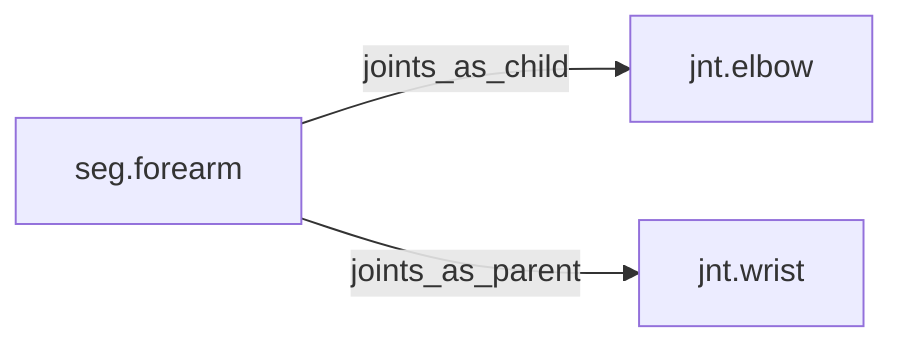

<!-- GENERATED by tools/thread (fy thread build) from thread/records, thread/stamps, decisions, params/snapshot.csv and sim/models/freyja.xml (snapshot sha256:492fe816e6d8), inputs sha256:8cf69c43b18c. Do not edit; change the inputs and rebuild. -->

# seg.forearm

Kind: segment. Status: **active**.

The forearm, from the elbow to the wrist.

## Binding and values

Model bodies: `forearm_left`, `forearm_right`. Values are read from the right side for a bilateral segment.

| snapshot key | value | sheet source |
|---|---|---|
| `forearm_right_com_x` | 0.00544815796694 | 'MuJoCo Reference'!D20 |
| `forearm_right_com_y` | -0.00492928577961 | 'MuJoCo Reference'!E20 |
| `forearm_right_com_z` | -0.106628234496 | 'MuJoCo Reference'!F20 |
| `forearm_right_ixx` | 0.00384471540622 | 'MuJoCo Reference'!G20 |
| `forearm_right_ixy` | -9.09991812122e-05 | 'MuJoCo Reference'!J20 |
| `forearm_right_ixz` | 0.000568744882576 | 'MuJoCo Reference'!K20 |
| `forearm_right_iyy` | 0.0035546555161 | 'MuJoCo Reference'!H20 |
| `forearm_right_iyz` | 0.000961178851554 | 'MuJoCo Reference'!L20 |
| `forearm_right_izz` | 0.00111473996985 | 'MuJoCo Reference'!I20 |
| `forearm_right_jpos_z` | 0 | 'MuJoCo Positions '!E10 |
| `forearm_right_length` | 0.259436093664 | 'MuJoCo Reference'!C20 |
| `forearm_right_mass` | 0.845 | 'MuJoCo Reference'!B20 |
| `forearm_right_pos_x` | 0 | 'MuJoCo Positions '!B10 |
| `forearm_right_pos_y` | 0 | 'MuJoCo Positions '!C10 |
| `forearm_right_pos_z` | -0.255234699434 | 'MuJoCo Positions '!D10 |

## Relations

Authored:

- body: `"forearm"`
- sides: `["left","right"]`

Derived:

- consumed_by: none
- crossed_by: none
- houses: none
- interfaces: none
- joints_as_child: [jnt.elbow](jnt.elbow.md)
- joints_as_parent: [jnt.wrist](jnt.wrist.md)
- reacted_by: none

## Budgets

Mass: target 0.845 kg, claimed 0 kg, remaining 0.845 kg.

## Work

None.

## Decisions

None.

## References

None in roadmap/nodes/.

Mentions in memos, notebook and log are not part of this file: run `python tools/fy thread refs seg.forearm`.

## Neighbourhood

