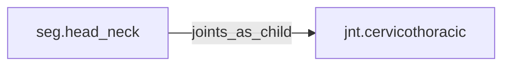

<!-- GENERATED by tools/thread (fy thread build) from thread/records, thread/stamps, decisions, params/snapshot.csv and sim/models/freyja.xml (snapshot sha256:e5cc96ceed7e), inputs sha256:22643998a882. Do not edit; change the inputs and rebuild. -->

# seg.head_neck

Kind: segment. Status: **active**.

The head and the cervical spine above the thorax.

## Binding and values

Model bodies: `head_and_neck`. Values are read from the right side for a bilateral segment.

| snapshot key | value | sheet source |
|---|---|---|
| `head_neck_com_x` | 0.00424586188341 | 'MuJoCo Reference'!D15 |
| `head_neck_com_y` | -0.000265366367713 | 'MuJoCo Reference'!E15 |
| `head_neck_com_z` | 0.152585661435 | 'MuJoCo Reference'!F15 |
| `head_neck_ixx` | 0.0257914592689 | 'MuJoCo Reference'!G15 |
| `head_neck_ixy` | -3.06676091188e-05 | 'MuJoCo Reference'!J15 |
| `head_neck_ixz` | -0.000490681745901 | 'MuJoCo Reference'!K15 |
| `head_neck_iyy` | 0.0276008482069 | 'MuJoCo Reference'!H15 |
| `head_neck_iyz` | 0 | 'MuJoCo Reference'!L15 |
| `head_neck_izz` | 0.0162231652238 | 'MuJoCo Reference'!I15 |
| `head_neck_jpos_z` | 0 | 'MuJoCo Positions '!E8 |
| `head_neck_length` | 0.265366367713 | 'MuJoCo Reference'!C15 |
| `head_neck_mass` | 4.355 | 'MuJoCo Reference'!B15 |
| `head_neck_pos_x` | 0 | 'MuJoCo Positions '!B8 |
| `head_neck_pos_y` | 0 | 'MuJoCo Positions '!C8 |
| `head_neck_pos_z` | 0 | 'MuJoCo Positions '!D8 |

## Relations

Authored:

- body: `"head_and_neck"`

Derived:

- consumed_by: none
- crossed_by: none
- houses: none
- interfaces: none
- joints_as_child: [jnt.cervicothoracic](jnt.cervicothoracic.md)
- joints_as_parent: none
- reacted_by: none

## Budgets

Mass: target 4.355 kg, claimed 0 kg, remaining 4.355 kg.

## Work

None.

## Decisions

None.

## References

None.

## Neighbourhood

