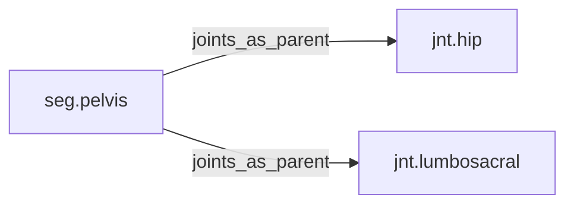

<!-- GENERATED by tools/thread (fy thread build) from thread/records, thread/stamps, decisions, params/snapshot.csv and sim/models/freyja.xml (snapshot sha256:e5cc96ceed7e), inputs sha256:de22d5e28a69. Do not edit; change the inputs and rebuild. -->

# seg.pelvis

Kind: segment. Status: **active**.

The pelvic girdle, which carries the hip joints.

## Binding and values

Model bodies: `pelvis`. Values are read from the right side for a bilateral segment.

| snapshot key | value | sheet source |
|---|---|---|
| `pelvis_com_x` | -0.00101007040359 | 'MuJoCo Reference'!D18 |
| `pelvis_com_y` | -0.000224460089686 | 'MuJoCo Reference'!E18 |
| `pelvis_com_z` | -0.0260373704036 | 'MuJoCo Reference'!F18 |
| `pelvis_ixx` | 0.0989845173877 | 'MuJoCo Reference'!G18 |
| `pelvis_ixy` | 1.19532082342e-05 | 'MuJoCo Reference'!J18 |
| `pelvis_ixz` | -0.0138179087188 | 'MuJoCo Reference'!K18 |
| `pelvis_iyy` | 0.0745999725899 | 'MuJoCo Reference'!H18 |
| `pelvis_iyz` | 1.19532082342e-05 | 'MuJoCo Reference'!L18 |
| `pelvis_izz` | 0.119532082342 | 'MuJoCo Reference'!I18 |
| `pelvis_jpos_z` | 0 | 'MuJoCo Positions '!E5 |
| `pelvis_length` | 0.112230044843 | 'MuJoCo Reference'!C18 |
| `pelvis_mass` | 9.49 | 'MuJoCo Reference'!B18 |
| `pelvis_pos_x` | 0 | 'MuJoCo Positions '!B5 |
| `pelvis_pos_y` | 0 | 'MuJoCo Positions '!C5 |
| `pelvis_pos_z` | 0.964735874439 | 'MuJoCo Positions '!D5 |

## Relations

Authored:

- body: `"pelvis"`

Derived:

- consumed_by: none
- crossed_by: none
- houses: none
- interfaces: none
- joints_as_child: none
- joints_as_parent: [jnt.hip](jnt.hip.md), [jnt.lumbosacral](jnt.lumbosacral.md)
- reacted_by: none

## Budgets

Mass: target 9.49 kg, claimed 0 kg, remaining 9.49 kg.

## Work

None.

## Decisions

None.

## References

- `docs/memos/memo18-stage3a-part-a.md:74` - Changed files after the edit: `part.hip.m2`, `seg.thigh`, `seg.pelvis`, `work.thigh-houses`, `work.pelvis-houses`, `work.m2-mount`, `work.pelvis-mass` (derived and dossier each, 14), plus `graph.jso

## Neighbourhood

