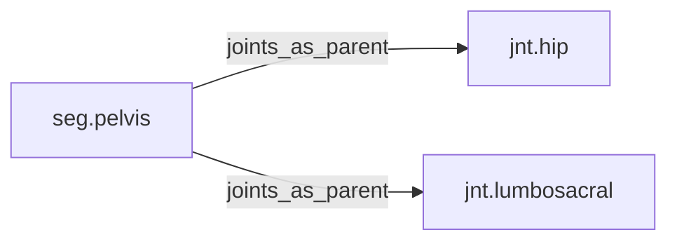

<!-- GENERATED by tools/thread (fy thread build) from thread/records, thread/stamps, decisions, params/snapshot.csv and sim/models/freyja.xml (snapshot sha256:492fe816e6d8), inputs sha256:7d73237a003e. Do not edit; change the inputs and rebuild. -->

# seg.pelvis

Kind: segment. Status: **active**.

The pelvic girdle, which carries the hip joints.

## Binding and values

Model bodies: `pelvis`. Values are read from the right side for a bilateral segment.

| snapshot key | value | sheet source |
|---|---|---|
| `pelvis_com_x` | -0.00101148566072 | 'MuJoCo Reference'!D18 |
| `pelvis_com_y` | -0.000224774591271 | 'MuJoCo Reference'!E18 |
| `pelvis_com_z` | -0.0260738525875 | 'MuJoCo Reference'!F18 |
| `pelvis_ixx` | 0.099262095438 | 'MuJoCo Reference'!G18 |
| `pelvis_ixy` | 1.19867281051e-05 | 'MuJoCo Reference'!J18 |
| `pelvis_ixz` | -0.0138566576894 | 'MuJoCo Reference'!K18 |
| `pelvis_iyy` | 0.0748091701037 | 'MuJoCo Reference'!H18 |
| `pelvis_iyz` | 1.19867281051e-05 | 'MuJoCo Reference'!L18 |
| `pelvis_izz` | 0.119867281051 | 'MuJoCo Reference'!I18 |
| `pelvis_jpos_z` | 0 | 'MuJoCo Positions '!E5 |
| `pelvis_length` | 0.112387295636 | 'MuJoCo Reference'!C18 |
| `pelvis_mass` | 9.49 | 'MuJoCo Reference'!B18 |
| `pelvis_pos_x` | 0 | 'MuJoCo Positions '!B5 |
| `pelvis_pos_y` | 0 | 'MuJoCo Positions '!C5 |
| `pelvis_pos_z` | 0.968752630054 | 'MuJoCo Positions '!D5 |

## Relations

Authored:

- body: `"pelvis"`

Derived:

- consumed_by: none
- crossed_by: none
- houses: none
- interfaces: none
- joints_as_child: none
- joints_as_parent: [jnt.hip](jnt.hip.md), [jnt.lumbosacral](jnt.lumbosacral.md)
- reacted_by: none

## Budgets

Mass: target 9.49 kg, claimed 0 kg, remaining 9.49 kg.

## Work

None.

## Decisions

None.

## References

None in roadmap/nodes/.

Mentions in memos, notebook and log are not part of this file: run `python tools/fy thread refs seg.pelvis`.

## Neighbourhood

