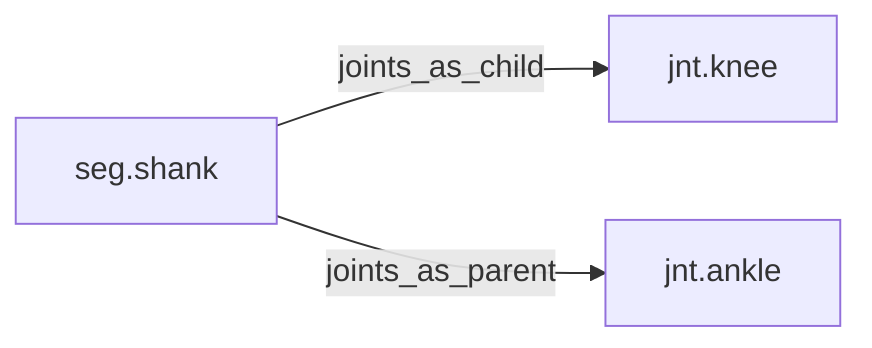

<!-- GENERATED by tools/thread (fy thread build) from thread/records, thread/stamps, decisions, params/snapshot.csv and sim/models/freyja.xml (snapshot sha256:492fe816e6d8), inputs sha256:104c8a7b21a6. Do not edit; change the inputs and rebuild. -->

# seg.shank

Kind: segment. Status: **active**.

The lower leg, from the knee to the ankle.

## Binding and values

Model bodies: `shank_left`, `shank_right`. Values are read from the right side for a bilateral segment.

| snapshot key | value | sheet source |
|---|---|---|
| `shank_right_com_x` | -0.0199692267722 | 'MuJoCo Reference'!D23 |
| `shank_right_com_y` | -0.0126335924477 | 'MuJoCo Reference'!E23 |
| `shank_right_com_z` | -0.164644237061 | 'MuJoCo Reference'!F23 |
| `shank_right_ixx` | 0.0380866057893 | 'MuJoCo Reference'!G23 |
| `shank_right_ixy` | -4.85798543231e-05 | 'MuJoCo Reference'!J23 |
| `shank_right_ixz` | 0.000194319417292 | 'MuJoCo Reference'!K23 |
| `shank_right_iyy` | 0.0380866057893 | 'MuJoCo Reference'!H23 |
| `shank_right_iyz` | -0.00174887475563 | 'MuJoCo Reference'!L23 |
| `shank_right_izz` | 0.00485798543231 | 'MuJoCo Reference'!I23 |
| `shank_right_jpos_z` | 0 | 'MuJoCo Positions '!E13 |
| `shank_right_length` | 0.407535240249 | 'MuJoCo Reference'!C23 |
| `shank_right_mass` | 2.925 | 'MuJoCo Reference'!B23 |
| `shank_right_pos_x` | 0 | 'MuJoCo Positions '!B13 |
| `shank_right_pos_y` | 0 | 'MuJoCo Positions '!C13 |
| `shank_right_pos_z` | -0.398082103233 | 'MuJoCo Positions '!D13 |

## Relations

Authored:

- body: `"shank"`
- sides: `["left","right"]`

Derived:

- consumed_by: none
- crossed_by: none
- houses: none
- interfaces: none
- joints_as_child: [jnt.knee](jnt.knee.md)
- joints_as_parent: [jnt.ankle](jnt.ankle.md)
- reacted_by: none

## Budgets

Mass: target 2.925 kg, claimed 0 kg, remaining 2.925 kg.

## Work

None.

## Decisions

None.

## References

None in roadmap/nodes/.

Mentions in memos, notebook and log are not part of this file: run `python tools/fy thread refs seg.shank`.

## Neighbourhood

