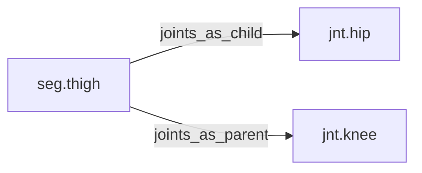

<!-- GENERATED by tools/thread (fy thread build) from thread/records, thread/stamps, decisions, params/snapshot.csv and sim/models/freyja.xml (snapshot sha256:492fe816e6d8), inputs sha256:19925e3d5ca9. Do not edit; change the inputs and rebuild. -->

# seg.thigh

Kind: segment. Status: **active**.

The thigh, from the hip to the knee.

## Binding and values

Model bodies: `thigh_left`, `thigh_right`. Values are read from the right side for a bilateral segment.

| snapshot key | value | sheet source |
|---|---|---|
| `thigh_right_com_x` | -0.0306523219489 | 'MuJoCo Reference'!D22 |
| `thigh_right_com_y` | -0.0035827389291 | 'MuJoCo Reference'!E22 |
| `thigh_right_com_z` | -0.150076952919 | 'MuJoCo Reference'!F22 |
| `thigh_right_ixx` | 0.144522313991 | 'MuJoCo Reference'!G22 |
| `thigh_right_ixy` | 0.000601549694031 | 'MuJoCo Reference'!J22 |
| `thigh_right_ixz` | 0.00736898375187 | 'MuJoCo Reference'!K22 |
| `thigh_right_iyy` | 0.153996721672 | 'MuJoCo Reference'!H22 |
| `thigh_right_iyz` | 0.00736898375187 | 'MuJoCo Reference'!L22 |
| `thigh_right_izz` | 0.0542898598863 | 'MuJoCo Reference'!I22 |
| `thigh_right_jpos_z` | 0 | 'MuJoCo Positions '!E12 |
| `thigh_right_length` | 0.398082103233 | 'MuJoCo Reference'!C22 |
| `thigh_right_mass` | 9.49 | 'MuJoCo Reference'!B22 |
| `thigh_right_pos_x` | 0.0567188220965 | 'MuJoCo Positions '!B12 |
| `thigh_right_pos_y` | -0.0924306730461 | 'MuJoCo Positions '!C12 |
| `thigh_right_pos_z` | -0.0976824158329 | 'MuJoCo Positions '!D12 |

## Relations

Authored:

- body: `"thigh"`
- sides: `["left","right"]`

Derived:

- consumed_by: none
- crossed_by: none
- houses: none
- interfaces: none
- joints_as_child: [jnt.hip](jnt.hip.md)
- joints_as_parent: [jnt.knee](jnt.knee.md)
- reacted_by: none

## Budgets

Mass: target 9.49 kg, claimed 0 kg, remaining 9.49 kg.

## Work

None.

## Decisions

None.

## References

None in roadmap/nodes/.

Mentions in memos, notebook and log are not part of this file: run `python tools/fy thread refs seg.thigh`.

## Neighbourhood

