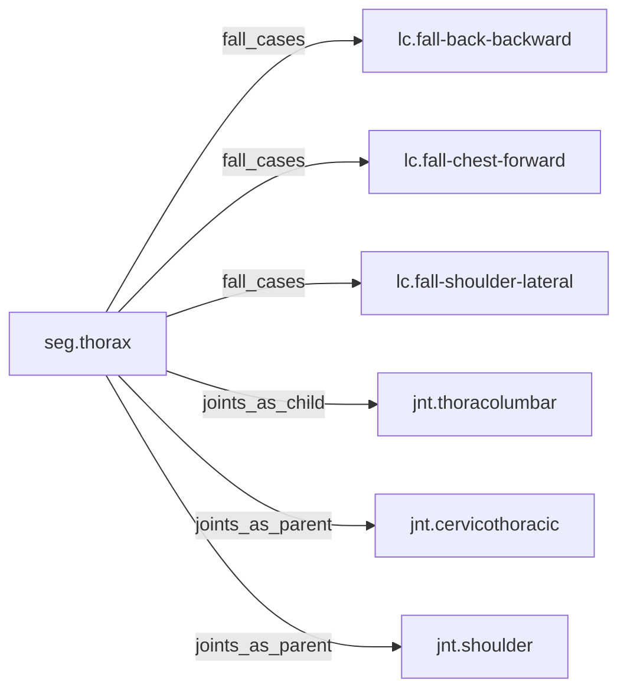

<!-- GENERATED by tools/thread (fy thread build) from thread/records, thread/stamps, decisions, params/snapshot.csv and sim/models/freyja.xml (snapshot sha256:492fe816e6d8), inputs sha256:f590e9904122. Do not edit; change the inputs and rebuild. -->

# seg.thorax

Kind: segment. Status: **active**.

The rib cage and thoracic spine.

## Binding and values

Model bodies: `thorax`. Values are read from the right side for a bilateral segment.

| snapshot key | value | sheet source |
|---|---|---|
| `thorax_com_x` | 0.00690394106741 | 'MuJoCo Reference'!D16 |
| `thorax_com_y` | -0.000328759098448 | 'MuJoCo Reference'!E16 |
| `thorax_com_z` | -0.173584803981 | 'MuJoCo Reference'!F16 |
| `thorax_ixx` | 0.281030774853 | 'MuJoCo Reference'!G16 |
| `thorax_ixy` | 0.00166290399321 | 'MuJoCo Reference'!J16 |
| `thorax_ixz` | -0.0266064638914 | 'MuJoCo Reference'!K16 |
| `thorax_iyy` | 0.226339710187 | 'MuJoCo Reference'!H16 |
| `thorax_iyz` | -0.000184767110357 | 'MuJoCo Reference'!L16 |
| `thorax_izz` | 0.201211383179 | 'MuJoCo Reference'!I16 |
| `thorax_jpos_z` | -0.328759098448 | 'MuJoCo Positions '!E7 |
| `thorax_length` | 0.328759098448 | 'MuJoCo Reference'!C16 |
| `thorax_mass` | 17.095 | 'MuJoCo Reference'!B16 |
| `thorax_pos_x` | 0 | 'MuJoCo Positions '!B7 |
| `thorax_pos_y` | 0 | 'MuJoCo Positions '!C7 |
| `thorax_pos_z` | 0.328759098448 | 'MuJoCo Positions '!D7 |

## Relations

Authored:

- body: `"thorax"`

Derived:

- consumed_by: none
- crossed_by: none
- fall_cases: [lc.fall-back-backward](lc.fall-back-backward.md), [lc.fall-chest-forward](lc.fall-chest-forward.md), [lc.fall-shoulder-lateral](lc.fall-shoulder-lateral.md)
- houses: none
- interfaces: none
- joints_as_child: [jnt.thoracolumbar](jnt.thoracolumbar.md)
- joints_as_parent: [jnt.cervicothoracic](jnt.cervicothoracic.md), [jnt.shoulder](jnt.shoulder.md)
- reacted_by: none

## Budgets

Mass: target 17.095 kg, claimed 0 kg, remaining 17.095 kg.

## Work

None.

## Decisions

None.

## References

- `roadmap/nodes/rm.v1-fall-cases-recorded.md:17` | lc.fall-shoulder-lateral | shoulder | lateral, shoulder first | 540 | E_max | seg.thorax | adr-0037 D1(b) |
- `roadmap/nodes/rm.v1-fall-cases-recorded.md:19` | lc.fall-back-backward | back | backward, back first | 540 | E_max | seg.thorax | adr-0037 D1(b) |
- `roadmap/nodes/rm.v1-fall-cases-recorded.md:20` | lc.fall-chest-forward | chest | forward, chest first, arm not arresting | 540 | E_max | seg.thorax | adr-0037 D1(b); adr-0044 D1 |
- `roadmap/nodes/rm.v1-fall-reserves-recorded.md:18` - **Unit counts.** D7 says `sides` as the segment and the mass is one unit. `seg.pelvis` and `seg.thorax` carry no `sides`, so a hip record would claim one unit where the table has two (and the should

Mentions in memos, notebook and log are not part of this file: run `python tools/fy thread refs seg.thorax`.

## Neighbourhood

