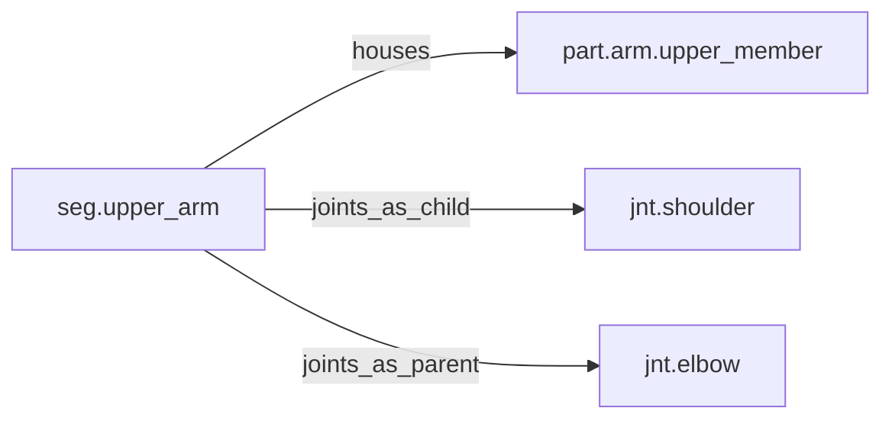

<!-- GENERATED by tools/thread (fy thread build) from thread/records, thread/stamps, decisions, params/snapshot.csv and sim/models/freyja.xml (snapshot sha256:492fe816e6d8), inputs sha256:28cc2738b847. Do not edit; change the inputs and rebuild. -->

# seg.upper_arm

Kind: segment. Status: **active**.

The upper arm, from the shoulder to the elbow.

## Binding and values

Model bodies: `upper_arm_left`, `upper_arm_right`. Values are read from the right side for a bilateral segment.

| snapshot key | value | sheet source |
|---|---|---|
| `upper_arm_right_com_x` | -0.0186321330587 | 'MuJoCo Reference'!D19 |
| `upper_arm_right_com_y` | 0.00714657158416 | 'MuJoCo Reference'!E19 |
| `upper_arm_right_com_z` | -0.115876553543 | 'MuJoCo Reference'!F19 |
| `upper_arm_right_ixx` | 0.0101447967628 | 'MuJoCo Reference'!G19 |
| `upper_arm_right_ixy` | 0.000232892487668 | 'MuJoCo Reference'!J19 |
| `upper_arm_right_ixz` | 8.38412955605e-05 | 'MuJoCo Reference'!K19 |
| `upper_arm_right_iyy` | 0.0101447967628 | 'MuJoCo Reference'!H19 |
| `upper_arm_right_iyz` | -0.00182587710332 | 'MuJoCo Reference'!L19 |
| `upper_arm_right_izz` | 0.00269223715744 | 'MuJoCo Reference'!I19 |
| `upper_arm_right_jpos_z` | 0 | 'MuJoCo Positions '!E9 |
| `upper_arm_right_length` | 0.255234699434 | 'MuJoCo Reference'!C19 |
| `upper_arm_right_mass` | 1.43 | 'MuJoCo Reference'!B19 |
| `upper_arm_right_pos_x` | 0.0138136749663 | 'MuJoCo Positions '!B9 |
| `upper_arm_right_pos_y` | -0.192328859146 | 'MuJoCo Positions '!C9 |
| `upper_arm_right_pos_z` | -0.0775690978875 | 'MuJoCo Positions '!D9 |

## Relations

Authored:

- body: `"upper_arm"`
- sides: `["left","right"]`

Derived:

- consumed_by: none
- crossed_by: none
- houses: [part.arm.upper_member](part.arm.upper_member.md)
- interfaces: none
- joints_as_child: [jnt.shoulder](jnt.shoulder.md)
- joints_as_parent: [jnt.elbow](jnt.elbow.md)
- reacted_by: none

## Budgets

Mass: target 1.43 kg, claimed 0.121239 kg, remaining 1.308761 kg.
  - [part.arm.upper_member](part.arm.upper_member.md): 1 x 0.121239 kg, part.arm.upper_member right (mass from cad/sidecars/part.arm.upper_member.json#/mass_properties/mass_kg) = 0.121239 kg

## Work

None.

## Decisions

None.

## References

None in roadmap/nodes/.

Mentions in memos, notebook and log are not part of this file: run `python tools/fy thread refs seg.upper_arm`.

## Neighbourhood

