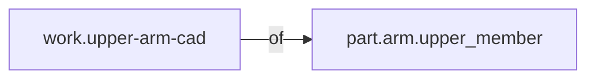

<!-- GENERATED by tools/thread (fy thread build) from thread/records, thread/stamps, decisions, params/snapshot.csv and sim/models/freyja.xml (snapshot sha256:492fe816e6d8), inputs sha256:5b612b60a437. Do not edit; change the inputs and rebuild. -->

# work.upper-arm-cad

Kind: work_item. Status: **proposed** (PROPOSED: not yet accepted).

The CAD model of the placeholder upper-arm member, pulled into its sidecar by the bridge (Stage 3b).

## Binding and values

No model or snapshot binding.

## Relations

Authored:

- of: [part.arm.upper_member](part.arm.upper_member.md)
- consumes: `["snapshot#/upper_arm_right_length"]`
- mode: `"assisted"`
- output: `"cad/sidecars/part.arm.upper_member.json"`

Derived:

- consumed_by: none

## Budgets

None.

## Work

Status: **current** (baseline stamp 20261027-2231).
Owner: [part.arm.upper_member](part.arm.upper_member.md). Mode: assisted.

## Decisions

None.

## References

- `roadmap/nodes/rm.v1-upper-arm-designed.md:13` Manual until the real design's work item (`work.upper-arm-cad`, revised from the bridge placeholder `p1`) consumes the upper arm's requirement records; then the criterion becomes `{type: work, work: w

Mentions in memos, notebook and log are not part of this file: run `python tools/fy thread refs work.upper-arm-cad`.

## Neighbourhood

